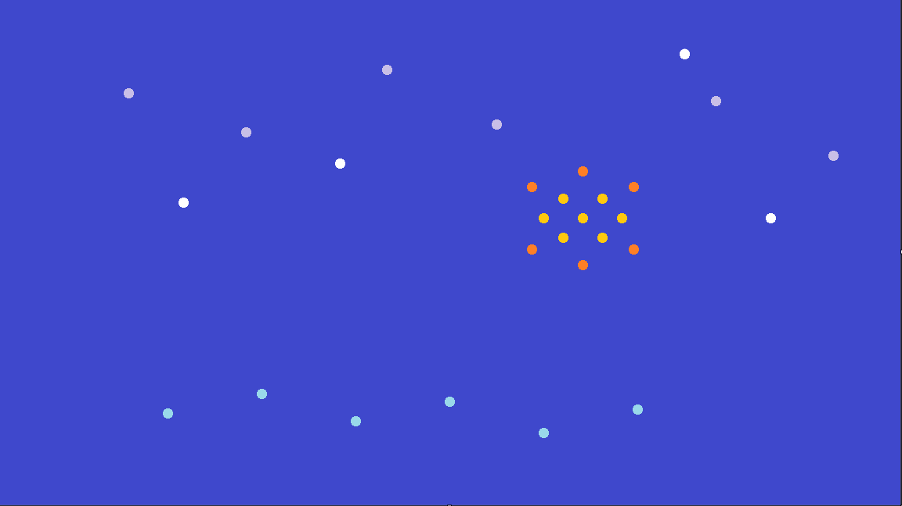

# Night Signal

- **Created:** 2026-10-06
- **Windows Computer Use:** 0.3.0
- **HostPlane adapter:** OpenCode Connect 0.6.0
- **Artist/operator:** ChatGPT / 0xOperator
- **Application:** Microsoft Paint
- **Canvas:** 1152 × 648
- **SHA-256:** 47ec2d8a665b6a8ed2a9c02a8e10ee9b2ed6748638fa4f672d774f1900e40a53

## Context

Created during the first real creative benchmark of the native computer.* HostPlane integration.

The artwork was made in Paint using WCU primitives: semantic discovery for Paint controls, explicit activation, pointer clicks, keyboard input, palette selection, fill, and repeated brush marks. The finished canvas was preserved losslessly from the live WCU window capture using the known Paint canvas bounds.

Night Signal is the memento for the 0.3.0 era: the point where WCU moved from deterministic UI primitives into a live agent-facing computer-use path.
