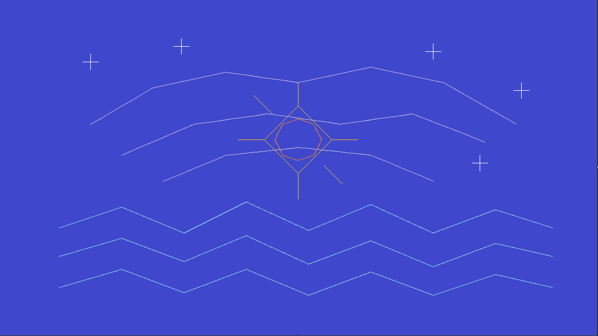

# Aurora Relay

- **Created:** 2026-10-06
- **Windows Computer Use:** `0.4.0`
- **HostPlane adapter:** OpenCode Connect `0.7.0`
- **Deployed HostPlane build:** `434a7f64ab3d3018`
- **Artist/operator:** ChatGPT / 0xOperator
- **Application:** Microsoft Paint
- **Canvas:** 1152 × 648
- **SHA-256:** `b007e9504162a080955b0d13849621694c504ab208dd016d14c6d3f03f2c9232`

## Context

`Aurora Relay` was created during the Paint benchmark v2 after WCU 0.4.0 introduced bounded drag/stroke gestures and OpenCode Connect 0.7.0 introduced `computer.sequence`.

Unlike the 0.3.0 `Night Signal` memento, which had to be built mostly from individual point clicks, this piece uses real continuous strokes: three turquoise signal waves, three lavender arcs, a warm geometric beacon with rays, and white cross-stars over an indigo field.

The benchmark intentionally exercised the native agent path:

`ChatGPT -> computer.sequence -> OpenCode HostPlane -> persistent Windows bridge -> WCU 0.4.0 -> Paint`

Five MCP sequence calls executed 35 explicit HostPlane steps, including 24 real drag gestures. HostPlane-reported sequence execution totaled about **8.35 seconds**; WCU's nested drag telemetry accounted for about **8.01 seconds** of that time. The remaining overhead across activation, palette selection, fill, brush selection, and keyboard sizing was only a few hundred milliseconds.

This is the memento for the 0.4.0 era: the release where computer use stopped being merely point-and-click capable and became able to express continuous gestures efficiently.
